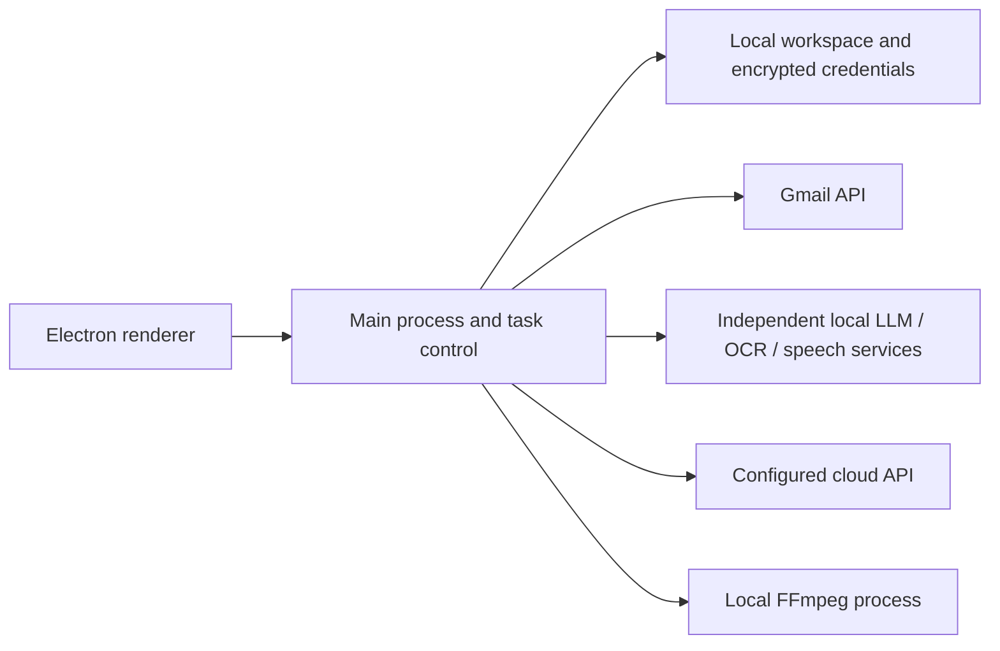

<p align="center">
  
</p>

# UFriend

**A Windows workspace for email, recordings, image text, and everyday writing.**

UFriend keeps your workspace on your computer and connects to separately configured local or cloud AI services. Review the original material alongside the result, edit it, and decide how to use it. The interface supports English and Traditional Chinese, with light, dark, and system themes.

**Current version: 0.1.38 · Windows x64 · Electron 44**

[Releases](https://github.com/breeze0305/UFriend/releases) · [Documentation](docs/README.md) · [使用手冊（繁體中文）](docs/guides/APP_README.md) · [Report an issue](https://github.com/breeze0305/UFriend/issues)

## Features

| Workflow | Available functionality |
| --- | --- |
| Email | Import EML files or connect Gmail; read HTML mail, manage attachments and drafts, send mail, summarize and classify messages, and schedule daily organization. |
| Recordings | Import audio or video, choose a transcription language, queue or schedule jobs, jump to timestamps, and edit or export TXT and SRT transcripts. |
| Captioned video | Burn timed subtitles into a new MP4 with progress and cancellation, keeping the source video. Requires the optional FFmpeg runtime. |
| Image text | Import an image or read a clipboard image, run OCR, compare the source with editable text, and copy the result. Automatic clipboard capture is opt-in. |
| Writing | Stream chat responses, keep separate conversations, translate text, and polish writing by purpose and tone. Optional profile context and task prompts are configurable. |
| Workspace | Local persistence and recovery backups, data cleanup, diagnostics, and system tray operation. |

AI results need review. Mail summaries currently use Traditional Chinese, independently of the interface language. Meeting tools provide transcription and subtitles; speaker diarization and automatic meeting summaries are not implemented.

## Run the Windows release

1. Open [GitHub Releases](https://github.com/breeze0305/UFriend/releases) and download the Windows x64 release ZIP. GitHub's **Source code** archives are not runnable desktop packages.
2. Extract the **entire ZIP** into a normal folder. Keep the adjacent DLLs, `resources`, `locales`, and license files with the executable.
3. If another version is running, quit it from the system tray menu, then launch `UFriend.exe` from the extracted folder.
4. For English, open **設定 → 一般 → 軟體介面語言**, choose **English**, and save.

The desktop package does not require Node.js. AI models and services are installed separately.

**Optional media runtime:** the public ZIP does not include the FFmpeg executable. For captioned-video export or cloud speech transcription, run `Install media runtime.cmd` in the extracted application folder. The installer downloads the pinned build from Gyan's official site and verifies its hashes. It needs 7-Zip; an already extracted package can instead be supplied through the PowerShell installer's `-From` option. See the [runtime guide](docs/development/FFMPEG_RUNTIME.md) for exact commands and paths. Local Whisper uses its own independently installed runtime.

Workspace data is separate from the application folder. Use the data-location control in **Settings → General** to find it. Fully quit UFriend before backing up the workspace or replacing application files.

## Configure AI and Gmail

### Local AI

The desktop repository contains HTTP adapters, **not model weights or model-service source code**. The following services are independent projects and are currently available by contacting the maintainer. Cloning this repository or installing a desktop release does not install them.

| Service | Default endpoint | Current implementation |
| --- | --- | --- |
| PC LLM API | `http://127.0.0.1:8765` | Qwen2.5-1.5B-Instruct Q4_K_M with llama.cpp CUDA |
| PC OCR API | `http://127.0.0.1:8767` | PP-OCRv5 mobile detection and recognition on CPU |
| PC Whisper API | `http://127.0.0.1:8768` | Multilingual Whisper Small with PyTorch CUDA; Base is optional |

Install and start each required service using its own README. In the local model settings, select PC API, save the endpoints, and test the connections. Only loopback endpoints are supported for these services. UFriend does not install, start, or stop them. See the [PC model guide](docs/guides/PC_MODELS.md) for requirements.

### Cloud AI

Configure your own compatible API endpoint, key, and text, vision, or speech model in the cloud settings. Text and OCR use the OpenAI-compatible Chat Completions format; speech requires Audio Transcriptions with segment timestamps. Compatibility varies by provider and model.

Text, OCR, and speech have separate defaults, and you can select a source for each task. A failed task does not automatically switch to another source. See [model sources and data flows](docs/guides/MODEL_SOURCES.md).

### Gmail

Bring your own **Google Desktop OAuth client configuration**. Enable Gmail API in your Google Cloud project, configure its consent screen and permitted users, then import the downloaded Desktop client JSON in **Settings → Email accounts → Advanced settings**. Follow the [Gmail setup guide](docs/guides/GMAIL_SETUP_GUIDE.md), then authorize your account in the system browser.

The repository and public release contain an empty OAuth template; no shared client or Gmail credentials are supplied. EML import and local drafts can be used without a Gmail connection. Connected mail currently supports Gmail only.

## Build from source

Use Windows x64 with Node.js 24.x, npm, Windows PowerShell 5.1, and the .NET Framework 4.x C# compiler. Electron is installed through the lockfile. The desktop itself does not require Python or CUDA; separate model services have their own requirements.

```powershell
git clone https://github.com/breeze0305/UFriend.git
cd UFriend
npm ci
npm run build:native
```

Prepare the pinned FFmpeg runtime and the `UFRIEND_TEST_FFMPEG` test path as described in the [installation guide](docs/guides/INSTALL_BUILD.md) and [FFmpeg runtime guide](docs/development/FFMPEG_RUNTIME.md). Then run:

```powershell
npm run check
npm test
npm start
```

After quitting the app, create a Windows portable package without an embedded FFmpeg executable:

```powershell
npm run package -- --without-ffmpeg
```

For a local package using the prepared FFmpeg runtime, use `npm run package`. The output is written to `dist/UFriend-<version>/`, or a timestamped directory if that version already exists. Packaging does not run the full test suite for you. See the installation guide for isolated development data, UI smoke tests, media prerequisites, and packaging details.

## Architecture and data



- Mail, files, settings, and completed work are stored locally. Ordinary workspace files are not encrypted by UFriend. Credentials use Electron `safeStorage`, backed by the Windows user account.
- Gmail operations connect to Google. External email images connect to their source websites. Local inference does not make every feature offline.
- Cloud tasks send the necessary input to the configured endpoint. Chat includes the current conversation history; enabled profile context is included only in the applicable text tasks. Provider retention and charges depend on the provider.
- Model output does not independently send mail, delete messages, create calendar events, or execute programs.

UGen300 integration is not implemented or verified on hardware. Device-pool timing simulations in the interface do not perform model inference. Outlook, Yahoo, and calendar integrations are also outside the current supported scope.

## Documentation and project files

- [User and developer documentation](docs/README.md)
- [Model adapter contracts](app/models/README.md)
- [Windows clipboard component](app/native/README.md)
- [Contributing](CONTRIBUTING.md) and [security reporting](SECURITY.md)

`app/` contains the desktop application, `scripts/` the build and verification tools, and `tests/` the automated tests. Dependencies, release output, credentials, personal data, and model runtimes are excluded from source control.

## License and third-party components

UFriend is licensed under the [MIT License](LICENSE).

Third-party components retain their respective licenses. These include Electron, Lucide, DOMPurify, MailParser, Nodemailer, and OpenCC. The separately installed FFmpeg build has its own license; UFriend's MIT license does not replace it. See [third-party notices](THIRD_PARTY_NOTICES.md), the [FFmpeg runtime and source information](docs/development/FFMPEG_RUNTIME.md) and [Google asset attribution](app/assets/GOOGLE-BRANDING.md).
