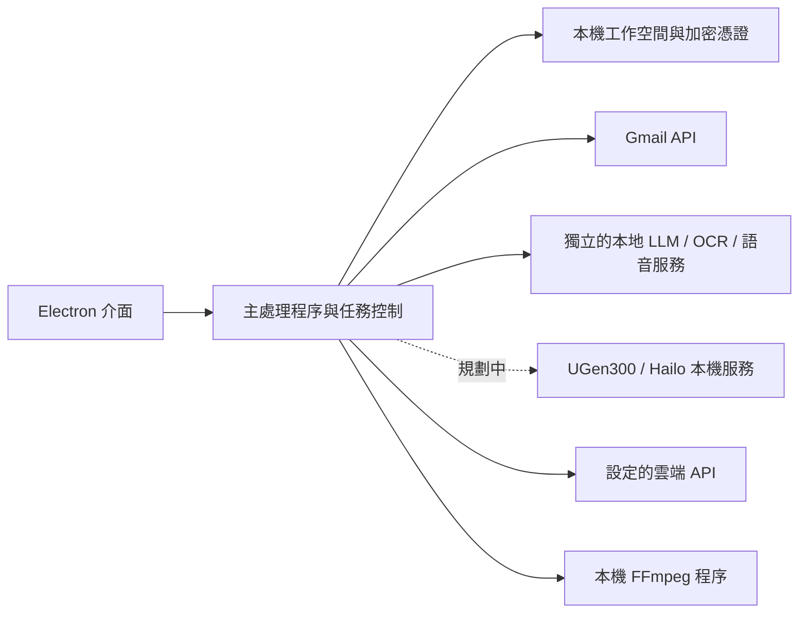

<p align="center">
  
</p>

# UFriend

[English](README.md) | [繁體中文](README.zh-TW.md)

**以 ASUS UGen300 本地運算為主要設計方向的 Windows AI 工作空間。**

UFriend 將郵件、錄音、圖片文字與日常寫作整合在同一個本機工作空間，並以 **ASUS UGen300** 為主要目標硬體：讓專用 USB AI 加速器成為日常使用的桌面助理。你可以對照原始素材與各項處理結果、編輯內容，再決定如何使用。介面支援英文與繁體中文，以及淺色、深色和跟隨系統的佈景主題。

**版本：0.1.41 · Windows x64 · Electron 44**

[下載版本](https://github.com/breeze0305/UFriend/releases) · [文件導覽](docs/README.zh-TW.md) · [使用手冊](docs/guides/APP_README.zh-TW.md) · [回報問題](https://github.com/breeze0305/UFriend/issues)

## 以 ASUS UGen300 為核心的設計

UGen300 是 UFriend 的主要目標硬體平台。預期使用方式是搭配相容模型與本機服務，讓使用者透過熟悉的桌面工作流程使用 AI 加速器。

| 設計重點 | 預期效益 |
| --- | --- |
| 本地處理資料 | 讓支援的文字、圖片與語音任務在連接的加速器上處理，模型輸入保留在使用者自己的電腦與裝置。 |
| 低功耗 AI 加速 | 由專用 AI 處理器執行支援的推論工作，搭配適合日常桌面使用的硬體功耗。 |
| 分擔主機負載 | 將支援的模型推論交給加速器及其專用記憶體，電腦負責介面、檔案與任務協調。 |
| 整合日常工作 | 將本地 AI 帶入郵件整理、OCR、逐字稿、翻譯與寫作，讓使用者在同一套工作空間完成操作。 |

ASUS 公布的 UGen300 USB 型號搭載 Hailo-10H 處理器、**8 GB LPDDR4**，提供最高 **40 TOPS（INT4）** 算力與 **2.5 W 典型功耗**。這些是廠商公布的加速器規格；UFriend 的模型相容性、延遲、處理量與整機功耗仍須實機量測。來源見 [ASUS 官方產品頁](https://www.asus.com/tw/motherboards-components/ai-accelerator/ugen/ugen300-usb-8g/)。

**目前實作進度：**桌面工作流程已可透過另外設定的 PC 模型服務或雲端 API 使用。UGen300 裝置後端與 Hailo SDK 整合仍待完成，選擇預留的 UGen300 選項尚不會在裝置上執行推論；裝置池的時間模擬也不會執行模型推論。整合介面與後續工作見[模型介接說明](app/models/README.zh-TW.md#後續-ugen300)。

目前文字、OCR 與語音皆預設採本地處理，任務失敗也不會自動改送雲端。Gmail、郵件外部圖片與使用者明確選用的雲端 AI 仍會連網，詳見[模型來源與資料流向](docs/guides/MODEL_SOURCES.zh-TW.md)。

## 功能

| 工作流程 | 可用功能 |
| --- | --- |
| 郵件 | 匯入 EML 或連接 Gmail；閱讀 HTML 郵件、管理附件與草稿、寄信、摘要及分類郵件，並排程每日整理。 |
| 錄音 | 匯入音訊或影片、選擇轉錄語言、排隊或排程處理、跳轉時間點，以及編輯或匯出 TXT 與 SRT 逐字稿。 |
| 字幕影片 | 將有時間軸的字幕燒錄成新 MP4，顯示進度並支援取消，保留原始影片。Windows 發布版內建 FFmpeg。 |
| 圖片文字 | 匯入圖片或讀取剪貼簿圖片、執行 OCR、對照原圖與可編輯文字，並複製結果。自動擷取剪貼簿須自行啟用。 |
| 寫作 | 串流對話回覆、保存不同對話、翻譯文字，並依用途與語氣潤飾內容。可設定選用的個人背景及任務提示詞。 |
| 工作空間 | 本機保存與恢復備份、資料清理、診斷，以及系統匣操作。 |

AI 結果需要人工核對。郵件摘要目前使用繁體中文，不隨介面語言改變。會議工具提供逐字稿與字幕，尚未實作說話者分離及自動會議摘要。

## 使用 Windows 發布版

1. 開啟 [GitHub Releases](https://github.com/breeze0305/UFriend/releases)，下載適用 Windows x64 的 **UFriend Windows EXE** 附件。執行 UFriend 不需要原始碼壓縮檔或另外提供的 FFmpeg 開發套件。
2. 將 EXE 存在要保留的資料夾。如果另一個版本仍在執行，先從系統匣選單正常結束。
3. 按兩下下載的 EXE 即可啟動，不需安裝精靈、Node.js 或手動解壓縮。
4. 如需英文介面，開啟 **設定 → 一般 → 軟體介面語言**，選擇 **English** 後儲存。

啟動器每次執行都會把程式展開到獨立的暫存目錄。工作資料與加密憑證仍保存在 Windows 使用者資料目錄，不放在下載的 EXE 或其暫存展開目錄內。從系統匣重新啟動時，會執行原本下載的 EXE；完全結束程式前，請將該檔案保留在原位置。

Windows 發布版內建 FFmpeg，用於字幕影片輸出及雲端語音轉錄前的音訊準備，不需另外安裝 FFmpeg 或 7-Zip。**設定 → 一般 → 影音元件** 會顯示已內建。發布頁也另外提供完整對應原始碼、依賴原始碼及建置腳本供下載。

舊版或未內建 FFmpeg 的自建版本則提供以下選裝操作：

- **下載並安裝影音元件**：從 Gyan 下載固定版本並核對雜湊；電腦須已安裝 7-Zip。
- **選擇已解壓的套件**：開啟資料夾選擇器，使用已解壓縮的官方套件，不會下載，也不需要 7-Zip。
- **影音元件安裝說明**：開啟[影音元件指南](docs/development/FFMPEG_RUNTIME.zh-TW.md)。

透過程式安裝的影音元件保存在使用者資料目錄，重新啟動或更換 EXE 後仍可使用。本地 Whisper 使用自己另外安裝的影音元件。AI 模型服務與 Gmail 仍須依下列步驟另外設定。

如果使用資料夾形式的 UFriend ZIP，請解壓縮**整個 ZIP**，將 DLL、資源與授權檔保留在一起，再執行其中的 `UFriend.exe`。未內建 FFmpeg 的 UFriend 資料夾套件也包含 `Install media runtime.cmd`，此替代方式見影音元件指南。另外提供的 FFmpeg 開發用 ZIP 不是 UFriend 應用程式套件。

可使用 **設定 → 一般** 的資料位置操作找到工作空間。備份資料或更換程式檔案前，請先完全結束 UFriend。

## 設定 AI 與 Gmail

### 本地 AI

桌面程式 repository 只包含 HTTP 介接器，**不包含模型權重或模型服務原始碼**。下列服務是獨立專案，目前需聯絡維護者取得。複製此 repository 或安裝桌面發布版，都不會一併安裝這些服務。

| 服務 | 預設端點 | 目前實作 |
| --- | --- | --- |
| PC LLM API | `http://127.0.0.1:8765` | 使用 llama.cpp CUDA 的 Qwen2.5-1.5B-Instruct Q4_K_M |
| PC OCR API | `http://127.0.0.1:8767` | 使用 CPU 的 PP-OCRv5 mobile 偵測與辨識模型 |
| PC Whisper API | `http://127.0.0.1:8768` | 使用 PyTorch CUDA 的多語版 Whisper Small；也可選擇 Base |

依各服務自己的 README 安裝並啟動所需服務。在 **設定 → 模型與運算 → 本地模型** 的 **本地執行環境** 選擇 **PC 本機服務**，儲存端點並測試連線。這些服務只支援本機 loopback 端點。UFriend 不會替你安裝、啟動或停止服務。環境需求見 [PC 模型服務指南](docs/guides/PC_MODELS.zh-TW.md)。

### 雲端 AI

在雲端設定中填入自己相容的 API 端點、金鑰，以及文字、視覺或語音模型。文字與 OCR 使用 OpenAI 相容的 Chat Completions 格式；語音需要支援片段時間戳的 Audio Transcriptions。相容程度依供應商與模型而異。

文字、OCR 與語音各有獨立預設，也可以為每個任務選擇來源。任務失敗時不會自動切換到其他來源。詳見[模型來源與資料流向](docs/guides/MODEL_SOURCES.zh-TW.md)。

### Gmail

請自備 **Google Desktop OAuth 用戶端設定**。在自己的 Google Cloud 專案啟用 Gmail API、設定同意畫面與允許使用的帳號，再到 **設定 → 郵件帳戶 → 進階設定（開發者）** 匯入下載的 Desktop 用戶端 JSON。依 [Gmail 設定指南](docs/guides/GMAIL_SETUP_GUIDE.zh-TW.md)完成設定後，在系統瀏覽器授權帳號。

repository 與公開發布版只包含空白 OAuth 範本，不提供共用用戶端或 Gmail 憑證。不連接 Gmail 也能匯入 EML 與使用本機草稿。目前連線郵件服務只支援 Gmail。

## 從原始碼建置

請使用 Windows x64、Node.js 24.x、npm、Windows PowerShell 5.1，以及 .NET Framework 4.x C# 編譯器。Electron 依 lockfile 安裝。桌面程式本身不需要 Python 或 CUDA；獨立模型服務有各自的環境需求。

```powershell
git clone https://github.com/breeze0305/UFriend.git
cd UFriend
npm ci
npm run build:native
```

依[安裝與編譯指南](docs/guides/INSTALL_BUILD.zh-TW.md)及 [FFmpeg 影音元件指南](docs/development/FFMPEG_RUNTIME.zh-TW.md)準備固定版本的 FFmpeg 與測試用 `UFRIEND_TEST_FFMPEG` 路徑，再執行：

```powershell
npm run check
npm test
npm start
```

結束程式後，建置單一 Windows EXE：

```powershell
npm run package:portable
```

此指令使用固定版本 electron-builder 26.17.0 的 NSIS portable 目標，首次建置需要網路下載建置工具。它先建立並驗證未內建 FFmpeg 或 OAuth 設定的資料夾套件，再將 `UFriend-<version>.exe` 與建置紀錄寫入 `local/releases/UFriend-<version>-portable-<timestamp>-<id>/`。已驗證的資料夾套件保留在 `dist/`。新建置使用不帶打包方式或影音元件後綴的檔名；已發布的附件保留原名稱。

若要建立在同一個 EXE 內建 FFmpeg 的發布格式，請先準備固定版本的 UFriend 自建影音元件，再執行：

```powershell
npm run package:portable -- --with-ffmpeg
```

這也會在獨立建置目錄產生 `UFriend-<version>.exe`，建置紀錄會註明是否包含 FFmpeg。內建影音元件的優先順序高於使用者資料目錄中的舊選裝版本。EXE 包含 GPL 授權、第三方聲明及來源資訊。發布時須同時提供相符的完整原始碼壓縮檔；只完成二進位建置仍未完成此步驟。詳見[影音元件指南](docs/development/FFMPEG_RUNTIME.zh-TW.md)。

若只要建立用於 ZIP 發布的資料夾套件，使用 `npm run package -- --without-ffmpeg`；要在本機資料夾套件中使用已準備好的 FFmpeg，則使用 `npm run package`。打包不會執行完整測試，也不會發布版本。隔離開發資料、UI smoke 測試、前置需求與打包細節見[安裝與編譯指南](docs/guides/INSTALL_BUILD.zh-TW.md)。

## 架構與資料



- 郵件、檔案、設定與已完成工作儲存在本機，通常位於 `%APPDATA%\UFriend\workspace`。UFriend 不會加密一般工作空間檔案。憑證使用 Electron `safeStorage`，由 Windows 使用者帳號保護。透過程式安裝的影音元件另外保存在 `%APPDATA%\UFriend\media-runtime\ffmpeg`。
- Gmail 操作會連接 Google；郵件中的外部圖片會連接圖片來源網站。本地推論不代表每項功能都能離線使用。
- 雲端任務會把必要輸入傳到設定的端點。對話包含目前對話歷史；啟用的個人背景只會加入適用的文字任務。供應商的資料保存及收費方式依其規定。
- 模型輸出不會自行寄信、刪除郵件、建立行事曆事件或執行程式。

圖中的 UGen300 虛線代表規劃中的硬體後端，詳見[以 ASUS UGen300 為核心的設計](#以-asus-ugen300-為核心的設計)。目前也不支援 Outlook、Yahoo 與行事曆整合。

## 文件與專案檔案

專案說明分為獨立英文（`.md`）與繁體中文（`.zh-TW.md`）檔案，兩份文件目錄都列出兩種語言的入口。

- [使用者與開發文件](docs/README.zh-TW.md)
- [模型介接契約](app/models/README.zh-TW.md)
- [Windows 剪貼簿元件](app/native/README.zh-TW.md)
- [參與貢獻](CONTRIBUTING.zh-TW.md)與[安全問題回報](SECURITY.zh-TW.md)

`app/` 放桌面程式，`scripts/` 放建置與驗證工具，`tests/` 放自動化測試。依賴、發布產物、憑證、個人資料及模型執行環境都排除在原始碼版本管理之外。

## 授權與第三方元件

UFriend 使用 [MIT 授權](LICENSE)。

第三方元件保留各自的授權，包括 Electron、Lucide、DOMPurify、MailParser、Nodemailer 與 OpenCC。FFmpeg 以獨立程序執行並使用自己的 GPL 授權，UFriend 的 MIT 授權不會取代它。詳見[第三方聲明](THIRD_PARTY_NOTICES.zh-TW.md)、[FFmpeg 影音元件與來源資訊](docs/development/FFMPEG_RUNTIME.zh-TW.md)及 [Google 素材來源](app/assets/GOOGLE-BRANDING.zh-TW.md)。
